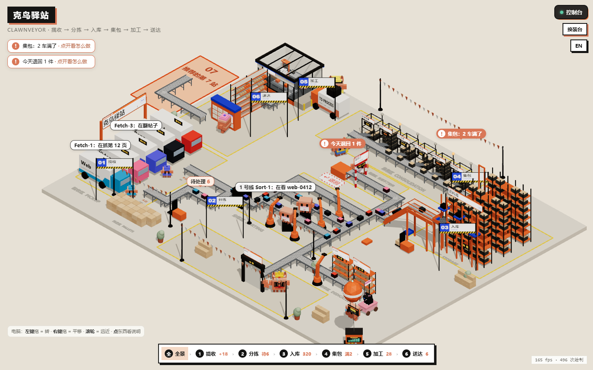

# Clawnveyor

**Your workflow as a little 3D warehouse.** Trucks bring things in, sorting lanes split them up, carts fill up and light when they're full, drones deliver the results. Each station shows real numbers from one JSON file, and a pixel Clawd stands wherever someone is working.

[中文说明](README.zh-CN.md) · [Live demo](https://miaomiaomeowmeow.github.io/clawnveyor/) (sample data)

> **The author is looking for a job!** If you have an opportunity, see [my website](https://miaomiaoyang.netlify.app) or reach out on [LinkedIn](https://www.linkedin.com/in/miaomiao-yang-331901383) · Xiaohongshu (RedNote) @羊猫猫不是猫 · [more](#contact)


## What you get

- **Six stations in fixed spots**: Pickup → Sort → Store → Pack → Process → Deliver. Rename them to fit your own flow: research notes, AI scraping, writing and publishing, anything that moves step by step.
- **Every flow ends with a harvest.** Station 06 is always the finish line, like the hub in a factory game, so nothing stops halfway down the road.
- **Stations you don't use stay put.** They go grey, get yellow-black caution tape and a PAUSED stamp on their sign. Nobody works there and the machines stop; belts and trucks carry things straight through to 06.
- **Two looks for the finish (06)**: *Simple*, a parcel locker where each project signs for its parcels (default); or *Clawdfield*, a little project base with a power hub, which links to my other open-source project [Clawdfield](https://github.com/Miaomiaomeowmeow): a project workbench where every project has a Clawd employee that keeps to-dos and finished work, plus a desktop pet. Switch in Console → Stations, or set `"use_style": "base"` in `data/flow.json`.
- **Six templates with sample data**: Collect → Skills, AI research → Results, Content (ideas → draft → review → publish), CI/CD (code → tests → artifacts → release → deploy → live), Data pipeline (extract → validate → warehouse → aggregate → model → serve), Blank. The first time you open the page it asks you to pick one.
- **Click anything** (a truck, a cart, a shelf) for a card with its numbers. Orange `!` bubbles show where something needs you.
- Chinese / English, a wardrobe for the Clawds, a few scene color themes.

| Two stations paused | Station switches | English, on a phone |
|---|---|---|
|  |  |  |

| Finish: simple parcel locker (default) | Finish: Clawdfield project base |
|---|---|
|  |  |

Machine workflows fit the same six stations:

| CI/CD | Data pipeline |
|---|---|
|  |  |

## Run it

You need Python 3 and a browser (the page loads three.js from a CDN, so it needs internet).

```bash
python tools/build.py
```

Then open `out/clawnveyor.html`. With no data of your own yet, it uses the sample data in `templates/`.

**Use your own numbers**

1. Copy a template, e.g. `templates/content.json`, to `data/flow.json`.
2. Edit names and numbers (anything ending in `_en` is the English text).
3. Run `python tools/build.py` again. The page is a snapshot; rebuild whenever the numbers change.

Other commands:

```bash
python tools/build.py --template crawl-result
```

previews one template's sample data, and

```bash
python tools/build.py --stress
```

fills every row past its limit to check the MORE stands (`out/stress.html`).

**Turn stations on / off**: in the page, Console → Stations, tap and "Save & reload" (saved in this browser). To make it stick for everyone, set `"on": false` for that station in `data/flow.json`. 06 is the finish line and always stays on.

## Let your scripts report numbers

CI jobs, data pipelines and AI batch jobs can update the board with one command each. `tools/flow.py` edits `data/flow.json` and rebuilds the page, so nobody has to edit the JSON by hand:

```bash
python tools/flow.py count waiting 12                          # set a count
python tools/flow.py count done +1                             # add one (-1 subtracts)
python tools/flow.py crew runner-1 "Unit tests 412/980" --active   # who is doing what (--idle, --remove)
python tools/flow.py log runner-3 "#479 failed -> sent back"   # a line in the console log
python tools/flow.py station shop off                          # turn a station off (on to turn it back)
python tools/flow.py cart Prod +1                              # one more in a pack cart; lights up when full
python tools/flow.py show                                      # print the current numbers
```

- If there's no `data/flow.json` yet, the first command copies one from a template (`--template ci-cd` picks which one, or run `python tools/flow.py init ci-cd`).
- Several scripts on the same machine can call it at the same time: changes wait their turn behind a lock file, so no count gets lost.
- Sending many updates at once? Add `--no-build` to each and run `python tools/flow.py build` once at the end.
- Text is shown as you write it. Add `--en "..."` if you want a separate English line for the English page.
- Also: `output NAME +1` (count at an output), `shelf NAME +1` (finished-goods shelf). `python tools/flow.py -h` lists everything.

**Example: GitHub Actions.** Put this folder in your repo as `clawnveyor/`. Each push runs the tests, reports to the board, and publishes the page on GitHub Pages (turn on Settings → Pages → Source: GitHub Actions):

```yaml
# .github/workflows/clawnveyor.yml
name: clawnveyor
on: [push]
permissions: { contents: read, pages: write, id-token: write }
jobs:
  test:
    runs-on: ubuntu-latest
    environment: { name: github-pages }
    env:
      TZ: Asia/Shanghai          # times on the board in your time zone (runners use UTC)
    steps:
      - uses: actions/checkout@v4
      - uses: actions/setup-python@v5
        with: { python-version: '3.12' }
      - run: python clawnveyor/tools/flow.py init ci-cd --no-build
      - run: python clawnveyor/tools/flow.py crew runner-1 "Testing ${GITHUB_SHA::7}" --active --no-build
      - id: tests
        run: npm test            # your own test command
        continue-on-error: true
      - if: steps.tests.outcome == 'success'
        run: |
          python clawnveyor/tools/flow.py count done +1 --no-build
          python clawnveyor/tools/flow.py log runner-1 "${GITHUB_SHA::7} passed" --no-build
      - if: steps.tests.outcome == 'failure'
        run: |
          python clawnveyor/tools/flow.py count today_returned +1 --no-build
          python clawnveyor/tools/flow.py log runner-1 "${GITHUB_SHA::7} failed -> sent back" --no-build
      - run: python clawnveyor/tools/flow.py crew runner-1 "Done" --idle     # this one rebuilds the page
      - run: mkdir site && cp clawnveyor/out/clawnveyor.html site/index.html
      - uses: actions/upload-pages-artifact@v3
        with: { path: site }
      - uses: actions/deploy-pages@v4
      - if: steps.tests.outcome == 'failure'
        run: exit 1              # still mark the run as failed
```

Each Actions run starts on a fresh machine, so this board shows that one run. Jobs on different machines each have their own copy; the lock only coordinates scripts on the same machine.

## data/flow.json at a glance

| Field | What it is |
|---|---|
| `title`, `unit` | Name on the top left, the unit for counts (items, posts, notes…) |
| `stations` | The six stations: `id`, `on`, `name`, `en` (sign text), `desc` |
| `roles`, `lanes` | What the workers are called; names of the three sorting lanes |
| `sources` | One truck per source: `name`, `en`, `worker`, `color`, `url`, `steps` |
| `crew` | Who is working right now: `text`, `time`, `active` (`role: "prep"` for the workshop) |
| `counts` | `waiting`, `unloading`, `done`, `today_in`, `today_done`, `today_returned`, `stored` |
| `outputs` | Where sorted things go: one `main` library, plus side shelves (`process: true`) and exit doors (`process: false`) |
| `carts`, `shelf` | Pack carts (`need` / `have`), the finished-goods shelf (`mine` / `all`) |
| `projects`, `links` | Who receives the deliveries; optional links for the Process and Deliver stations |
| `log` | Latest lines for the console log |

## Adding a 7th station

The scene has six stations. To add a seventh, ask your AI (Claude Code, Codex, Cursor…) to edit `dashboard-template.html` as below, then add a line to `stations` in `data/flow.json`.



- **Recommended spot (orange in the picture)**: next to 06, just outside the top-left corner of today's floor. When a 7th station is added, the floor grows to cover it; until then it isn't there.
- **How to connect it**: one belt from 06 with a single turn into 07. No detours.
- **The harvest still comes last**: if 07 comes after 06, it becomes the new finish line, so the parcel locker moves to the last station.
- **Adding one in the middle** (say, an extra check after Pack): put it behind the row of pack carts and branch it off the pack line.
- **Somewhere else is fine too**: just tell your AI where. Or sketch a simple route map (which station connects to which, roughly in which direction) and send it to your AI to follow.

A line you can paste to your AI:

```text
Add a 7th station to my Clawnveyor called ____. Put it on the "recommended spot for station 7" from the README (next to 06; grow the floor to cover it) and connect it from 06 with a single turn. The last station should hold the parcel locker (the harvest). Edit dashboard-template.html, add a line to stations in data/flow.json, run python tools/build.py and show me a screenshot.
```

## Not there yet

- No live updates. `flow.py` rebuilds the page, but a page that's already open doesn't refresh itself, and jobs on different machines can't share one board yet. A small local server for that is planned.
- The six stations stay in fixed spots and can't be reordered. A 7th station means asking your AI to edit the scene (see "Adding a 7th station"); there's no one-click way yet.
- The ✨ AI buttons in the wardrobe only work when the page is opened as a Claude artifact. Everything else works in any browser.

## Contact

**I'm looking for a job!** If you have a role that fits, I'd love to hear from you:

- LinkedIn: [Miaomiao Yang](https://www.linkedin.com/in/miaomiao-yang-331901383) (new projects get posted there too)
- Xiaohongshu (RedNote): @羊猫猫不是猫
- GitHub: [Miaomiaomeowmeow](https://github.com/Miaomiaomeowmeow) (my other projects)
- Personal site (résumé + more playful projects): [miaomiaoyang.netlify.app](https://miaomiaoyang.netlify.app); my email is there too

In the page itself: click Miaomiao's little pink cart.

## Credits & license

Made by **Miaomiao** ([@Miaomiaomeowmeow](https://github.com/Miaomiaomeowmeow)).

Licensed under [CC BY-NC-SA 4.0](https://creativecommons.org/licenses/by-nc-sa/4.0/): you can share and remix it with credit, share your version under the same license, and not use it commercially. If you build something on it, I'd really love to hear about it.

Clawd is the Claude Code mascot; this is a fan project and not affiliated with Anthropic. 3D by [three.js](https://threejs.org/) (MIT).
