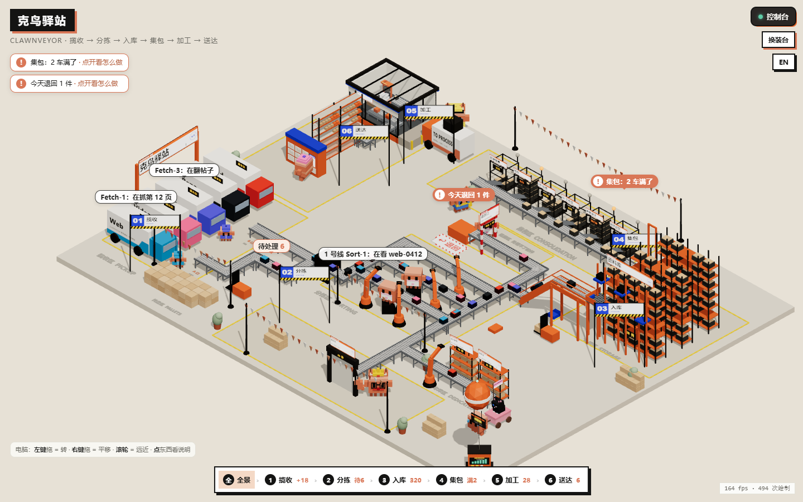
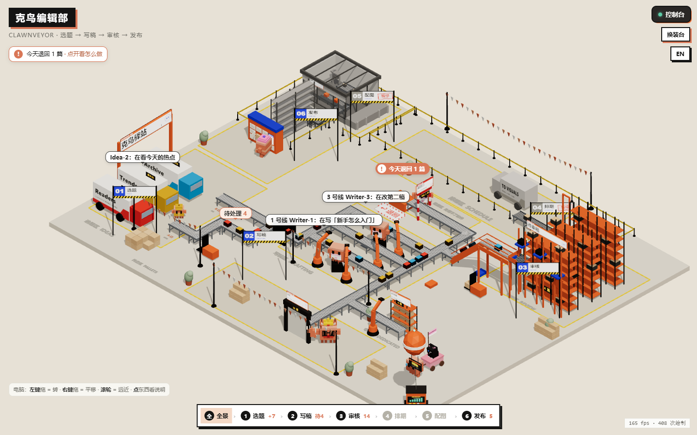
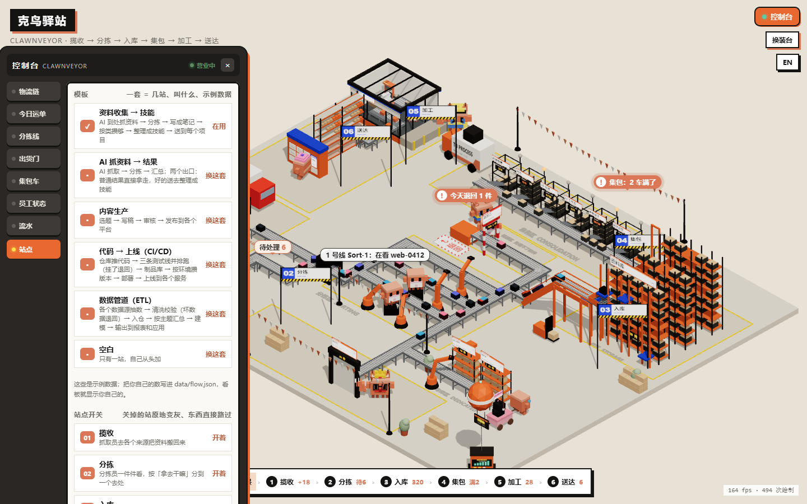
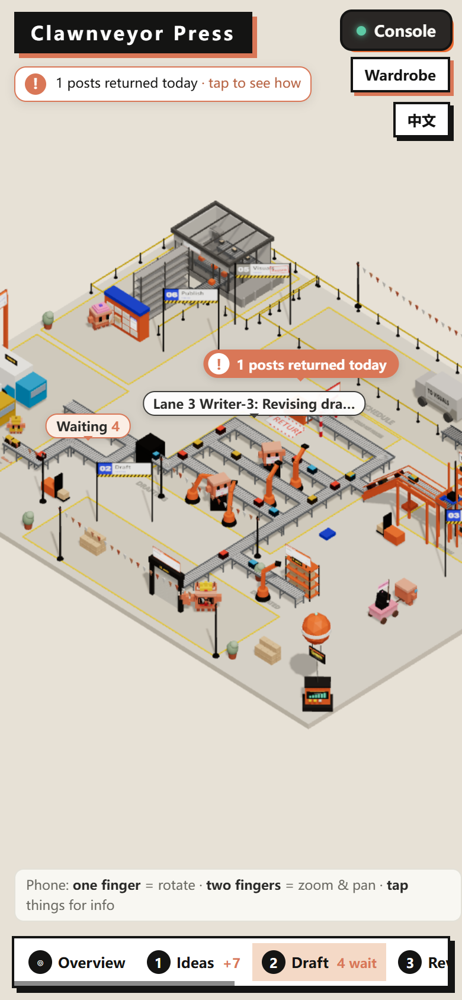
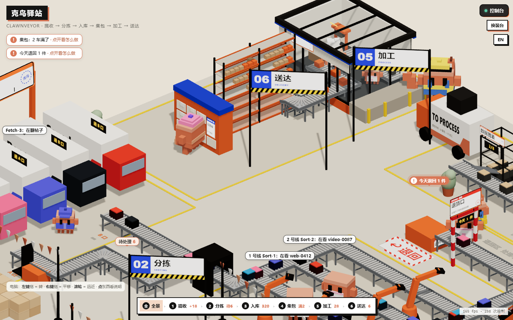
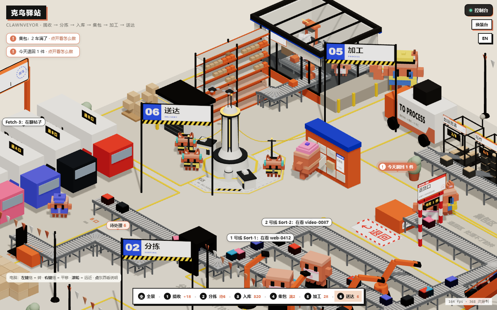
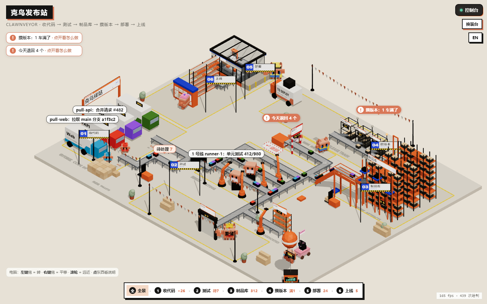
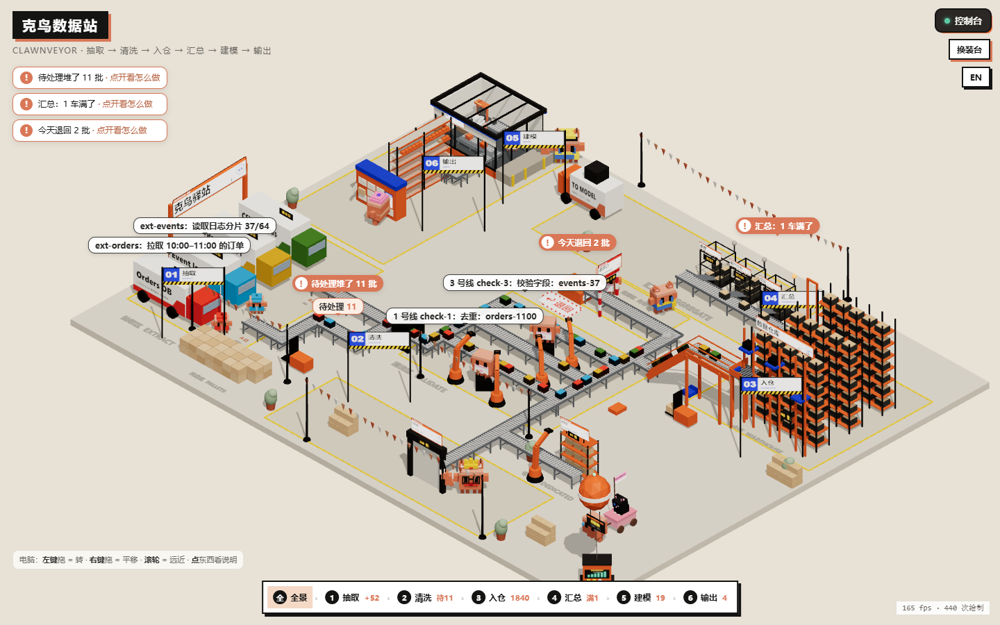

# 克鸟驿站 Clawnveyor

**把你的工作流程摆成一座 3D 小仓库。** 卡车把东西拉进来，分拣线一件件分开，集包车装满了亮灯，无人机把成品送出去。每一站的数都来自一个 JSON 文件；谁在干活，那一站就站着一只像素小克。

[English](README.md) · [在线看看](https://miaomiaomeowmeow.github.io/clawnveyor/)（示例数据）

> **作者在找工作！** 有工作机会请看 [我的网站](https://miaomiaoyang.netlify.app) 或在 [LinkedIn 领英](https://www.linkedin.com/in/miaomiao-yang-331901383) 联系我 · 小红书 @羊猫猫不是猫 · [更多联系方式](#联系作者)



## 有什么

- **6 站，位置固定**：揽收 → 分拣 → 入库 → 集包 → 加工 → 送达。站名可以改成你自己的流程：收集资料、AI 抓东西、写稿发稿……只要是一步一步往下走的都行。
- **最后一定是收获**：06 永远是终点，像工厂游戏里的收货中心，东西不会停在半路。
- **不用的站不收起来**：原地变灰、拉一圈黄黑警戒带、站牌上盖「暂停」章。里面没人、机器停，传送带和车照样把东西直接送过去，最后都到 06。
- **终点 06 有两种样子**：*简洁版*是快递签收柜，一格一个项目，包裹放进去就是签收了（默认）；*终未地版*是一个小小的项目基地加中枢电站，和作者的另一个开源项目「今日小克终未地」（[Clawdfield](https://github.com/Miaomiaomeowmeow)）联动。那是一个项目工作台：每个项目一只小克员工，记待办、收好作品，还能配一只桌面宠物。在 控制台 → 站点 里切换，或者在 `data/flow.json` 写 `"use_style": "base"`。
- **6 套模板，都带示例数据**：资料收集 → 技能、AI 抓资料 → 结果、内容生产（选题 → 写稿 → 审核 → 发布）、CI/CD（收代码 → 测试 → 制品库 → 攒版本 → 部署 → 上线）、数据管道（抽取 → 清洗 → 入仓 → 汇总 → 建模 → 输出）、空白。第一次打开会先请你挑一套。
- **东西都能点**：卡车、集包车、货架，点了弹一张小卡写着现在的数。哪里要你处理，就冒一个橙色的 `!`。
- 中文 / 英文、小克换装台、几套场景配色。

| 两站暂停 | 站点开关 | 手机上的英文版 |
|---|---|---|
|  |  |  |

| 终点：简洁版快递签收柜（默认） | 终点：终未地版项目基地 |
|---|---|
|  |  |

机器跑的流程也能套进这 6 站：

| CI/CD | 数据管道 |
|---|---|
|  |  |

## 怎么打开

要有 Python 3 和浏览器（网页从网上加载 three.js，打开时要联网）。

```bash
python tools/build.py
```

然后用浏览器打开 `out/clawnveyor.html`。还没有自己的数据时，用 `templates/` 里的示例。

**换成自己的数**

1. 挑一套模板，比如把 `templates/content.json` 复制成 `data/flow.json`
2. 改名字和数字（字段名后面带 `_en` 的是英文版用的字）
3. 再跑一次 `python tools/build.py`。网页是一张快照，数变了就重新跑

别的用法：

```bash
python tools/build.py --template crawl-result
```

看某一套模板的示例；

```bash
python tools/build.py --stress
```

把每一排都塞到超过上限，看 MORE 台子摆得对不对（生成 `out/stress.html`）。

**开 / 关某一站**：网页里 控制台 → 站点，点一下再点「保存并刷新」（记在这个浏览器里）。想一直关着，就在 `data/flow.json` 里把那一站写成 `"on": false`。06 是终点，一直开着。

## 让机器自己报数

CI、数据管道、AI 批量任务，每报一个数就是一行命令。`tools/flow.py` 会改 `data/flow.json`，再重新生成网页，不用手改 JSON：

```bash
python tools/flow.py count waiting 12                          # 设成 12
python tools/flow.py count done +1                             # 加一（-1 减一）
python tools/flow.py crew runner-1 "Unit tests 412/980" --active   # 谁在干什么（--idle 歇着，--remove 下班）
python tools/flow.py log runner-3 "#479 failed -> sent back"   # 控制台流水加一行
python tools/flow.py station shop off                          # 关掉一站（on 打开）
python tools/flow.py cart Prod +1                              # 集包车多一件，满了会亮灯
python tools/flow.py show                                      # 看现在的数
```

- 还没有 `data/flow.json` 时，第一条命令会先从模板复制一份（`--template ci-cd` 选哪套，或者先跑 `python tools/flow.py init ci-cd`）
- 同一台电脑上几个脚本同时报也没关系：改之前排队拿锁，数不会丢
- 一下子要报好多个：每条加 `--no-build`，最后跑一次 `python tools/flow.py build`
- 写什么字就显示什么字；英文版想显示另一句，加 `--en "..."`
- 还有 `output 名字 +1`（出口的数）、`shelf 名字 +1`（成品货架）。`python tools/flow.py -h` 看全部

**例子：GitHub Actions。** 把这个文件夹放进你的仓库，叫 `clawnveyor/`。每次推代码：跑测试、报数、把网页发到 GitHub Pages（先在 Settings → Pages → Source 选 GitHub Actions）：

```yaml
# .github/workflows/clawnveyor.yml
name: clawnveyor
on: [push]
permissions: { contents: read, pages: write, id-token: write }
jobs:
  test:
    runs-on: ubuntu-latest
    environment: { name: github-pages }
    env:
      TZ: Asia/Shanghai          # 看板上的时间用北京时间（GitHub 的机器默认是世界标准时间）
    steps:
      - uses: actions/checkout@v4
      - uses: actions/setup-python@v5
        with: { python-version: '3.12' }
      - run: python clawnveyor/tools/flow.py init ci-cd --no-build
      - run: python clawnveyor/tools/flow.py crew runner-1 "Testing ${GITHUB_SHA::7}" --active --no-build
      - id: tests
        run: npm test            # 换成你自己的测试命令
        continue-on-error: true
      - if: steps.tests.outcome == 'success'
        run: |
          python clawnveyor/tools/flow.py count done +1 --no-build
          python clawnveyor/tools/flow.py log runner-1 "${GITHUB_SHA::7} passed" --no-build
      - if: steps.tests.outcome == 'failure'
        run: |
          python clawnveyor/tools/flow.py count today_returned +1 --no-build
          python clawnveyor/tools/flow.py log runner-1 "${GITHUB_SHA::7} failed -> sent back" --no-build
      - run: python clawnveyor/tools/flow.py crew runner-1 "Done" --idle     # 这一条会重新生成网页
      - run: mkdir site && cp clawnveyor/out/clawnveyor.html site/index.html
      - uses: actions/upload-pages-artifact@v3
        with: { path: site }
      - uses: actions/deploy-pages@v4
      - if: steps.tests.outcome == 'failure'
        run: exit 1              # 测试没过，这次运行还是标成失败
```

GitHub Actions 每次都在一台新机器上跑，所以看板上是这一次运行的情况。几个任务在不同机器上并排跑时，各有各的一份；锁只管同一台电脑上的脚本。

## data/flow.json 里有什么

| 字段 | 是什么 |
|---|---|
| `title`、`unit` | 左上角的名字、数东西用的单位（件、篇、条……） |
| `stations` | 6 站：`id`、`on`（开不开）、`name`、`en`（站牌上的英文）、`desc` |
| `roles`、`lanes` | 各岗位叫什么；三条分拣线上的人叫什么 |
| `sources` | 一个来源一辆卡车：`name`、`en`、`worker`、`color`、`url`、`steps` |
| `crew` | 现在谁在干活：`text`、`time`、`active`（加工站的人写 `role: "prep"`） |
| `counts` | `waiting` 待处理、`unloading` 卸货中、`done`、`today_in`、`today_done`、`today_returned`、`stored` |
| `outputs` | 分好的东西去哪：一个 `main` 主库，加上专库（`process: true`）和外发门（`process: false`） |
| `carts`、`shelf` | 集包车（`need` 门槛 / `have` 装了几件）、成品货架（`mine` / `all`） |
| `projects`、`links` | 送达给哪些项目；加工站、送达站可以各填一个网址 |
| `log` | 控制台「流水」里最新的几行 |

## 还没做的

- 还不会实时更新：`flow.py` 会重新生成网页，但已经开着的网页要自己刷新；不同机器上的任务也还不能报到同一块看板上。以后会加一个本机小服务器
- 摆法是固定的：6 站、位置不变，还不能加第 7 站或者调顺序
- 换装台里的 ✨ AI 按钮，只有把网页当成 Claude 的 Artifact 打开时才能用；别的功能任何浏览器都行

## 联系作者

**我在找工作！** 有合适的机会，欢迎联系我：

- LinkedIn 领英：[Miaomiao Yang](https://www.linkedin.com/in/miaomiao-yang-331901383)（新作品也会发在这里，欢迎关注）
- 小红书：@羊猫猫不是猫
- GitHub：[Miaomiaomeowmeow](https://github.com/Miaomiaomeowmeow)（作者的其他作品）
- 个人网站（简历 + 更多好玩的作品）：[miaomiaoyang.netlify.app](https://miaomiaoyang.netlify.app)，邮箱也在上面

网页里也能找到：点喵喵坐的粉色小车。

## 作者和许可

作者 **Miaomiao**（GitHub [@Miaomiaomeowmeow](https://github.com/Miaomiaomeowmeow)）。

许可：[CC BY-NC-SA 4.0](https://creativecommons.org/licenses/by-nc-sa/4.0/deed.zh-hans)：可以转发、可以改，要写明出处；改了的版本要用同样的许可公开；不能拿去商用。如果你在它上面做了东西，非常希望告诉我一声。

小克（Clawd）是 Claude Code 的吉祥物；这是粉丝做的项目，和 Anthropic 没有关系。3D 用的是 [three.js](https://threejs.org/)（MIT 许可）。
